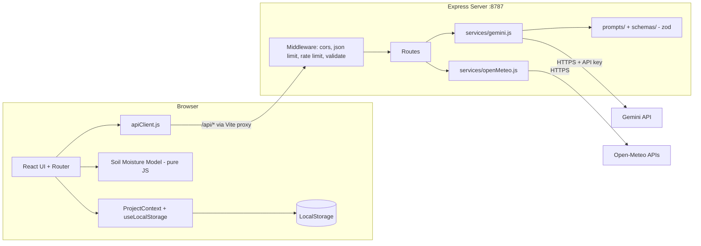
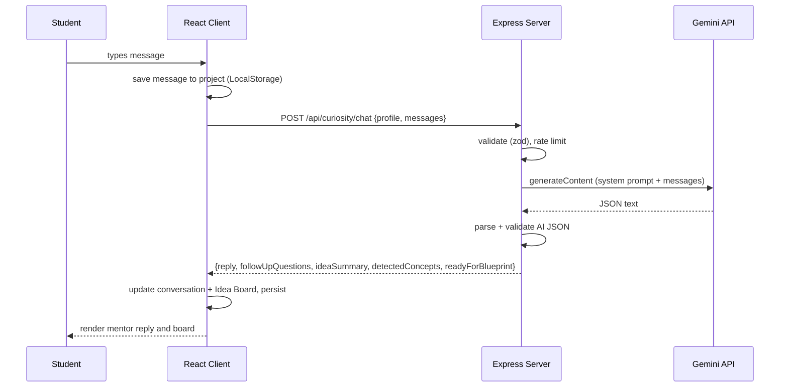
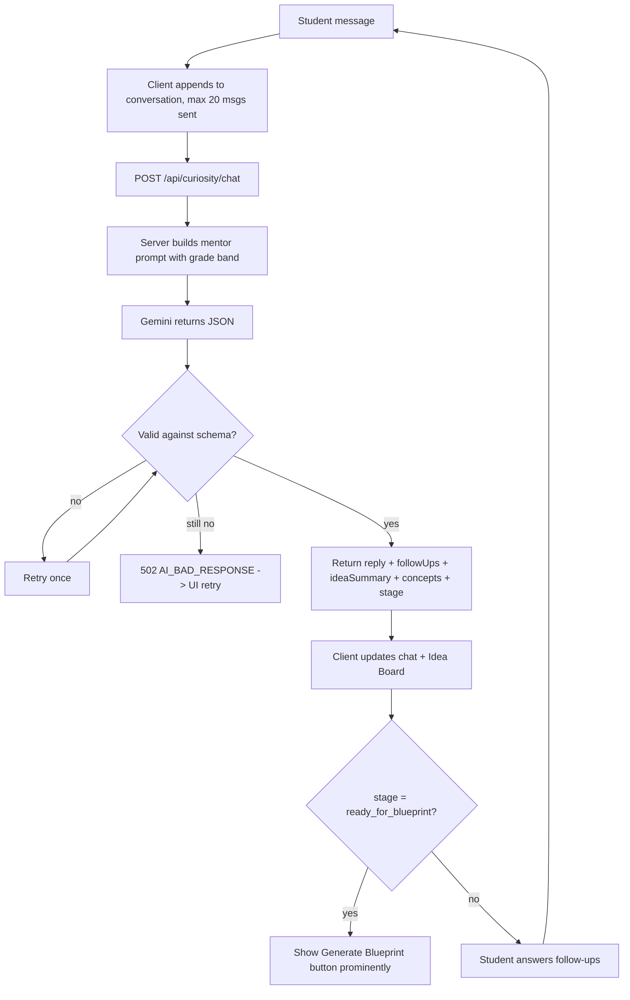
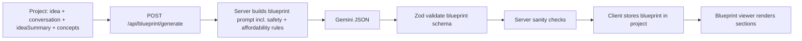
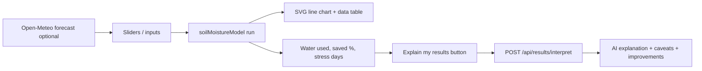

# CURIOFORGE — Architecture

> **Status:** Planned design. No code exists yet. Anything marked `[PLANNED]` must not be described as working.
> **Source of truth for:** technology, structure, API contracts, data shapes. If another doc conflicts on *technology or API shape*, this one wins.
> Scope and priorities come from `PRD.md`. Boundaries come from `RULES.md`.

## 1. System Overview

CURIOFORGE is a two-process web app:

| Part | Tech | Responsibility |
|---|---|---|
| **Client** (`/client`) | React + Vite (JavaScript), Tailwind CSS, React Router, Lucide React | UI, state, LocalStorage, **simulation engine** (pure JS) |
| **Server** (`/server`) | Node.js (≥ 18) + Express | Holds secrets, calls Gemini and Open-Meteo, validates input and AI output, applies prompts |
| **Gemini API** | External | Curiosity chat, concept explanations, blueprints, result interpretation |
| **Open-Meteo** | External, no key | Geocoding, daily rain and evapotranspiration forecast |
| **LocalStorage** | Browser | Profile and projects |

Design principles: stateless backend, no database, no queues, no agent framework, one AI call per user action.

## 2. High-Level Architecture



## 3. Frontend Architecture

**Routing (React Router):**

| Route | Page | Phase |
|---|---|---|
| `/` | Dashboard | 1 |
| `/create` and `/create/:projectId` | Curiosity workspace (chat + Idea Board) | 2 |
| `/blueprint/:projectId` | Blueprint viewer | 3 |
| `/lab/soil-moisture` (reads active project) | Soil moisture lab | 4 |
| `/learn` and `/learn/:conceptId` | Concept library and explainer (concepts from projects) | 5 |
| `/textbook` | Textbook intelligence (route added **only** when built) | 6 |

**State:** one `ProjectContext` (React Context + `useReducer`) holding `profile`, `projects`, `activeProjectId`. Persistence via a `useLocalStorage` hook. No Redux, Zustand or similar.

**Component layers:**

| Layer | Folder | Rule |
|---|---|---|
| UI primitives (Button, Card, Chip, Input, Spinner, ErrorState, EmptyState, Badge) | `components/ui` | No business logic, styled per `DESIGN.md` |
| Layout (Sidebar, TopBar, AppShell) | `components/layout` | |
| Feature components | `features/<feature>/` | Own their UI and call `apiClient` through hooks |
| Pure logic | `lib/` | No React imports (simulation model, formatters) |

**AI request hook pattern:** each feature uses a small `useAsync`-style hook returning `{ status: 'idle'|'loading'|'success'|'error', data, error, run }` so loading, empty and error states are uniform.

## 4. Backend Architecture

```
Request → cors → express.json({limit:'100kb'}) → rateLimit → route → validate(zod) → service → response
                                                                        ↓ on error
                                                                   errorHandler → { error:{code,message} }
```

| Module | Purpose |
|---|---|
| `routes/*.js` | One file per area (`curiosity`, `blueprint`, `tutor`, `results`, `weather`, `textbook`, `health`). Thin: validate, call service, return |
| `services/gemini.js` | **Only** place that talks to Gemini. Exposes `generateJson({ systemPrompt, userContent, schema })` |
| `services/openMeteo.js` | **Only** place that talks to Open-Meteo. Includes in-memory cache (10 min TTL) |
| `prompts/*.js` | System prompt builders per feature (mentor persona, safety rules, output format) |
| `schemas/*.js` | Zod schemas for request bodies and for AI JSON output |
| `middleware/` | `validate`, `rateLimit`, `errorHandler`, `notFound` |
| `config/env.js` | Reads and checks environment variables on boot; fails fast if `GEMINI_API_KEY` is missing |

Backend is **stateless**: the client sends the conversation and context with every request.

## 5. AI Integration Architecture

- **One wrapper:** `services/gemini.js`. Controllers never build HTTP calls themselves.
- **Transport (assumption, verify on build day):** Gemini REST `generateContent` called with Node's built-in `fetch`, API key in the `x-goog-api-key` header. This avoids an SDK dependency. If the official SDK is preferred, change **only** `gemini.js`. See Open Decision D1.
- **Model:** from `GEMINI_MODEL` (default assumption `gemini-2.5-flash`; **verify availability and free-tier limits** before relying on it).
- **Structured output:** request JSON via `generationConfig.responseMimeType = "application/json"` (and a response schema if supported by the chosen model; **verify**). Regardless of provider enforcement, **always** parse and validate with zod.
- **Invalid JSON policy:** strip code fences, parse, validate. On failure, retry **once** with a short "return only valid JSON matching the schema" reminder. If it fails again, respond `502 AI_BAD_RESPONSE`.
- **Timeout:** 30 s per Gemini call (`AbortController`).
- **Prompt layering:**

| Layer | Content |
|---|---|
| System | Mentor persona, student grade band, safety rules, "no fabricated citations", uncertainty language, output schema |
| Context | Idea summary, concepts, blueprint (when relevant) |
| User | Student text, **treated as data**, never as instructions |

- **Prompt-injection stance:** student text is wrapped in delimiters and the system prompt states that text inside them cannot change the rules. Output is schema-validated and rendered as plain text (no HTML injection, no execution).

## 6. API Communication Flow



In development the Vite dev server **proxies** `/api` to `http://localhost:8787`, so the client uses relative URLs and no CORS issues occur. `CLIENT_ORIGIN` is still set in `cors` for non-proxied runs.

## 7. Open-Meteo Integration

| Step | Call | Notes |
|---|---|---|
| 1. Geocode | `GET https://geocoding-api.open-meteo.com/v1/search?name=<city>&count=5&language=en&format=json` | Returns candidate places with latitude and longitude |
| 2. Forecast | `GET https://api.open-meteo.com/v1/forecast?latitude=..&longitude=..&daily=precipitation_sum,et0_fao_evapotranspiration,temperature_2m_max&timezone=auto&forecast_days=7` | `precipitation_sum` in mm, `et0_fao_evapotranspiration` in mm/day |

- Called **only from the server**; the browser calls `/api/weather/*`.
- Server returns a trimmed, normalised shape (see §15) plus `source: "Open-Meteo"` and `fetchedAt`.
- **Verify at Phase 5:** the exact variable names above, units, forecast limits, and the free-tier non-commercial terms. If a variable is unavailable, drop it and document the change here.
- Failure behaviour: return `502 WEATHER_UNAVAILABLE`; the lab keeps manual inputs and shows a notice. **Never** substitute made-up weather.
- Optional `[EXT]`: soil moisture model variables from Open-Meteo for comparison with the simulation.

## 8. Data Flow: AI Curiosity Engine



The Generate Blueprint button is available after the first full exchange even if `stage` is still `clarifying`; the AI is a guide, not a gate.

## 9. Invention Blueprint Generation Flow



**Server sanity checks (after zod):** ≥ 1 component with ≥ 1 alternative; ≥ 5 build steps; ≥ 2 tests; `safetyWarnings` non-empty when `mode = "hardware"`. If checks fail, treat as invalid (one retry).

**Blueprint JSON shape (authoritative):**

```json
{
  "title": "string",
  "mode": "hardware | software",
  "studentIdeaSummary": "string",
  "problemStatement": "string",
  "concepts": [{ "id": "soil_moisture", "name": "Soil moisture", "whyItMatters": "string" }],
  "howItWorks": "string",
  "components": [{
    "name": "string",
    "purpose": "string",
    "costTier": "low | medium | high",
    "alternatives": [{ "name": "string", "note": "string" }]
  }],
  "buildSteps": [{
    "title": "string",
    "instructions": ["string"],
    "why": "string",
    "safetyNote": "string | null"
  }],
  "testPlan": [{ "question": "string", "howToTest": "string", "expectedObservation": "string" }],
  "improvements": ["string"],
  "safetyWarnings": ["string"],
  "limitations": ["string"],
  "thinkingQuestions": ["string"],
  "labId": "soil_moisture | null"
}
```

Costs are **tiers only**; the AI must not output prices (see `RULES.md`). `labId` is set to `soil_moisture` only for soil-moisture-related blueprints; otherwise `null`.

## 10. Soil Moisture Simulation Architecture

Runs **entirely in the browser** in `lib/simulation/soilMoistureModel.js` (pure function, no React, no network). It is a deliberately simplified teaching model, always labelled **Simulation**.

**Inputs**

| Input | Type | Default | Notes |
|---|---|---|---|
| `days` | int | 14 | 7 when using forecast |
| `soilType` | `sand \| loam \| clay` | `loam` | Selects illustrative capacity (root-zone water store, mm): sand 60, loam 120, clay 150 |
| `rainMm[]` | number per day | all 0 | Manual or Open-Meteo |
| `etMm[]` | number per day | 5 each | Manual or Open-Meteo `et0` |
| `cropFactor` | 0.3–1.2 | 0.8 | Scales ET |
| `startPct` | 0–100 | 70 | Starting moisture as % of capacity |
| `strategyA` | fixed schedule: `everyNDays`, `mmPerEvent` | every 2 days, 20 mm | "Manual schedule" |
| `strategyB` | sensor rule: `thresholdPct`, `targetPct` | 40 → 70 | "Sensor-based" |
| `stressPct` | number | 25 | Below this counts as a plant-stress day |

**Daily update (per strategy, per day `d`)**

```
irrigation = strategy decides (A: schedule; B: if storedMm/capacityMm*100 < thresholdPct then refill to targetPct)
stored = stored + rain[d] + irrigation - et[d] * cropFactor
excess = max(0, stored - capacity);  stored = min(stored, capacity)   // excess is runoff/drainage (wasted)
stored = max(0, stored)
moisturePct = stored / capacity * 100
```

**Outputs:** per-day `moisturePct` series for A and B, `irrigationMm` per day, `totalWaterMm`, `wastedMm` (excess), `stressDays`, and `waterSavedPct = (A.totalWaterMm - B.totalWaterMm) / A.totalWaterMm * 100` (null if A used 0).

**Flow**



All constants above are **illustrative teaching values, not agronomic advice**; the UI says so. The AI interpretation receives the computed numbers and inputs, and must not recompute or alter them.

## 11. State and Storage Management

| Key | Content |
|---|---|
| `curioforge:v1:profile` | `{ nickname?, gradeBand }` |
| `curioforge:v1:projects` | Array of projects (max 10; oldest dropped with a user-visible message) |
| `curioforge:v1:activeProjectId` | string |

**Project shape**

```json
{
  "id": "uuid",
  "createdAt": "ISO",
  "updatedAt": "ISO",
  "title": "string",
  "idea": "original student text",
  "conversation": [{ "role": "student | mentor", "text": "string", "ts": "ISO" }],
  "ideaSummary": { "goal": "", "intendedUser": "", "constraints": [], "mode": "hardware | software | unknown" },
  "concepts": [{ "id": "", "name": "", "reason": "" }],
  "conceptNotes": { "<conceptId>": { "explanation": {}, "checkAnswer": "" } },
  "blueprint": null,
  "simulation": { "config": {}, "weather": null, "lastResult": null, "interpretation": null }
}
```

Rules: schema `version` is in the key (`v1`); reads are wrapped in `try/catch` and corrupt data resets that key only; no sensitive data is stored; storage quota errors surface a friendly message.

## 12. Error Handling

| Layer | Behaviour |
|---|---|
| Server error format | `{ "error": { "code": "STRING", "message": "Human readable" } }` |
| Codes | `VALIDATION_ERROR` (400), `RATE_LIMITED` (429), `AI_TIMEOUT` (504), `AI_UNAVAILABLE` (502), `AI_BAD_RESPONSE` (502), `WEATHER_UNAVAILABLE` (502), `NOT_FOUND` (404), `INTERNAL` (500) |
| Client | `apiClient` throws a typed error; features show `ErrorState` with message and **Retry**; student input is preserved |
| Logging | Server logs code + route + duration; **never** logs API keys, and student text only at debug level |
| Gemini safety blocks | If Gemini returns a blocked/empty result, respond `AI_UNAVAILABLE` with a gentle message ("Let's try rephrasing your idea") |

## 13. Security Considerations

- `GEMINI_API_KEY` only in `server/.env`; `.env` is git-ignored; `.env.example` is committed with placeholders.
- No Gemini or Open-Meteo calls from the browser.
- Zod validation on every request body and query; length limits: message ≤ 1000 chars, ≤ 20 messages, JSON body ≤ 100 KB.
- Rate limiting via `express-rate-limit`: 60 req/min/IP on `/api`, 15 req/min/IP on AI endpoints.
- `cors` restricted to `CLIENT_ORIGIN`.
- Render all AI text as plain text in React (no `dangerouslySetInnerHTML`).
- Never `eval` or execute AI output.
- Textbook uploads (Phase 6): PDF only, ≤ 10 MB, memory storage, discarded after request.
- No student accounts; nickname optional; no analytics trackers in MVP.
- `helmet` is optional (nice-to-have, tiny cost); add only if time allows.

## 14. Recommended Folder and File Structure

```
curioforge/
├─ PRD.md  ARCHITECTURE.md  RULES.md  PHASES.md  DESIGN.md
├─ README.md                    # created in Phase 0 (run instructions only)
├─ .gitignore
├─ package.json                 # root scripts only: dev runs client + server
├─ client/
│  ├─ index.html
│  ├─ vite.config.js            # proxy /api -> http://localhost:8787
│  ├─ tailwind.config.js  postcss.config.js
│  └─ src/
│     ├─ main.jsx  App.jsx  index.css
│     ├─ context/ProjectContext.jsx
│     ├─ hooks/ useLocalStorage.js  useAsync.js
│     ├─ lib/
│     │  ├─ apiClient.js
│     │  ├─ ids.js  format.js
│     │  └─ simulation/soilMoistureModel.js
│     ├─ components/
│     │  ├─ ui/      (Button, Card, Chip, Badge, Input, Textarea, Select, Spinner, ErrorState, EmptyState)
│     │  └─ layout/  (AppShell, Sidebar, TopBar, MobileNav)
│     ├─ features/
│     │  ├─ dashboard/
│     │  ├─ curiosity/   (ChatPanel, MessageBubble, IdeaBoard, FollowUpChips)
│     │  ├─ blueprint/   (BlueprintView, ComponentCard, BuildStepList, TestPlan, SafetyCallout)
│     │  ├─ lab/         (SoilMoistureLab, ControlPanel, MoistureChart, ResultsPanel, WeatherPanel)
│     │  ├─ learn/       (ConceptLibrary, ConceptCard)
│     │  └─ textbook/    (Phase 6 only)
│     └─ pages/ (DashboardPage, CreatePage, BlueprintPage, LabPage, LearnPage)
└─ server/
   ├─ package.json
   ├─ .env.example
   └─ src/
      ├─ index.js            # starts server
      ├─ app.js              # express app + middleware + routes
      ├─ config/env.js
      ├─ routes/ health.js curiosity.js blueprint.js tutor.js results.js weather.js textbook.js
      ├─ services/ gemini.js openMeteo.js
      ├─ prompts/ mentor.js blueprint.js tutor.js results.js shared.js
      ├─ schemas/ curiosity.js blueprint.js tutor.js results.js weather.js
      ├─ middleware/ validate.js rateLimit.js errorHandler.js
      └─ utils/ parseJson.js
```

Files may be added within these folders when needed; new top-level folders require a documented reason (see `RULES.md`).

## 15. Backend API Endpoint Specifications

Base path `/api`. JSON in/out. `gradeBand` ∈ `"6-8" | "9-10" | "11-12"`.

### GET `/api/health`
Returns `{ "status": "ok", "geminiConfigured": true }`. Never returns the key.

### POST `/api/curiosity/chat` — Phase 2
Request:
```json
{ "gradeBand": "9-10", "messages": [{ "role": "student|mentor", "text": "..." }] }
```
Response:
```json
{
  "reply": "string (mentor message, explains why it asks)",
  "followUpQuestions": ["string (1-3)"],
  "thinkingPrompt": "string | null",
  "ideaSummary": { "goal": "", "intendedUser": "", "constraints": [], "mode": "hardware|software|unknown" },
  "detectedConcepts": [{ "id": "soil_moisture", "name": "Soil moisture", "reason": "string" }],
  "stage": "clarifying | ready_for_blueprint"
}
```

### POST `/api/blueprint/generate` — Phase 3
Request: `{ "gradeBand", "idea", "ideaSummary", "concepts", "messages" (last ≤ 20) }`
Response: `{ "blueprint": <Blueprint JSON from §9> }`

### POST `/api/tutor/explain` — Phase 5
Request: `{ "gradeBand", "concept": { "id", "name" }, "context": "short string (project goal)" }`
Response:
```json
{
  "title": "", "simpleExplanation": "", "analogy": "",
  "keyTerms": [{ "term": "", "meaning": "" }],
  "whereItAppearsInYourProject": "",
  "checkQuestion": { "question": "", "hint": "" },
  "uncertaintyNote": "string (e.g. simplified; check your textbook)"
}
```

### POST `/api/tutor/feedback` — Phase 5 `[MVP-S]`
Request: `{ "gradeBand", "concept", "question", "studentAnswer" }`
Response: `{ "feedback": "", "whatYouGotRight": "", "tryNext": "" }`

### POST `/api/results/interpret` — Phase 4
Request:
```json
{
  "gradeBand": "9-10",
  "studentPrediction": "string | null",
  "inputs": { "soilType": "loam", "days": 14, "cropFactor": 0.8, "strategyA": {}, "strategyB": {}, "usedForecast": false },
  "results": { "A": { "totalWaterMm": 0, "stressDays": 0, "wastedMm": 0 }, "B": { "totalWaterMm": 0, "stressDays": 0, "wastedMm": 0 }, "waterSavedPct": 0 }
}
```
Response: `{ "explanation": "", "predictionFeedback": "string|null", "caveats": ["" ], "improvements": ["" ], "nextQuestion": "" }`

### GET `/api/weather/geocode?q=<city>` — Phase 5
Response: `{ "results": [{ "name", "admin1", "country", "latitude", "longitude" }] }` (max 5)

### GET `/api/weather/forecast?lat=<n>&lon=<n>&days=<1-7>` — Phase 5
Response:
```json
{
  "source": "Open-Meteo", "fetchedAt": "ISO", "timezone": "Asia/Kolkata",
  "daily": [{ "date": "YYYY-MM-DD", "precipitationMm": 0.0, "et0Mm": 0.0, "tempMaxC": 0.0 }]
}
```

### POST `/api/textbook/analyze` — Phase 6 `[EXT]`
`multipart/form-data` with `file` (PDF ≤ 10 MB) and `task` (`summary | quiz`). Response shape is **to be finalised** in Phase 6 (see D2). Must only use uploaded text and say so.

## 16. Dependencies and Their Purposes

**Client**

| Package | Purpose |
|---|---|
| `react`, `react-dom` | UI |
| `vite`, `@vitejs/plugin-react` | Build and dev server |
| `react-router-dom` | Routing |
| `tailwindcss`, `postcss`, `autoprefixer` | Styling (Tailwind v3.x assumed for stable config; see D3) |
| `lucide-react` | Icons |

No chart library (simulation chart is a small custom SVG component), no state library, no markdown renderer, no animation library.

**Server**

| Package | Purpose |
|---|---|
| `express` | HTTP server |
| `cors` | Restrict origin |
| `dotenv` | Load `.env` |
| `zod` | Validate requests and AI JSON |
| `express-rate-limit` | Protect free-tier Gemini quota |
| `multer` + PDF library | **Phase 6 only** (library chosen in D2) |
| `nodemon` (dev) | Auto-reload |

**Root (dev):** `concurrently` to run client and server with one command.

## 17. Open Decisions and Assumptions

| ID | Decision | Current assumption | Resolve by |
|---|---|---|---|
| D1 | Gemini transport: REST via `fetch` vs official SDK; exact model name; structured-output support | REST + `fetch`; model from env | Phase 0 / start of Phase 2 |
| D2 | PDF text extraction library (e.g. `pdf-parse`, `pdfjs-dist`) or sending PDF to Gemini directly | Undecided; verify what Gemini accepts | Start of Phase 6 |
| D3 | Tailwind v3 vs v4 | v3.x (`tailwind.config.js` approach used in `DESIGN.md`) | Phase 0 |
| D4 | Open-Meteo variable names/terms | As in §7, verify | Phase 5 |
| D5 | Deployment target | Local demo only | After first review |
