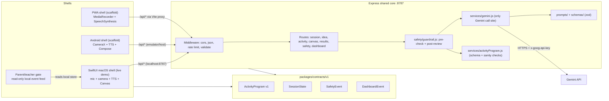
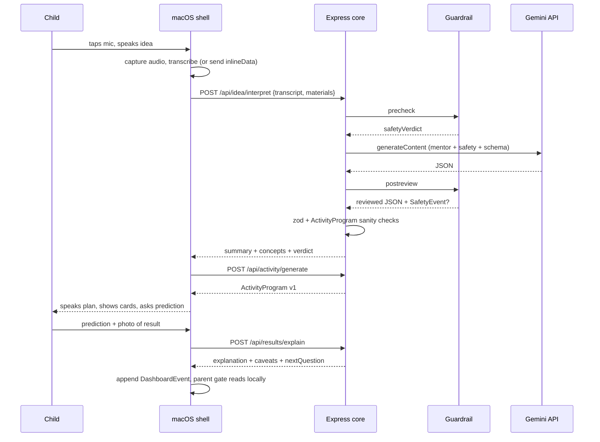

# CURIOFORGE — Architecture

> **Status:** Planned design. No code exists yet. Anything marked `[PLANNED]` must not be described as working.
> **Decision record:** `docs/designs/curioforge-unified-activity-plan.md` (approved) supersedes older drafts and explains the re-scope.
> **Source of truth for:** technology, structure, API contracts, data shapes. If another doc conflicts on *technology or API shape*, this one wins.
> Scope and priorities come from `PRD.md`. Boundaries come from `RULES.md`.

## 1. System Overview

CURIOFORGE is a **shared core + thin platform shells** system, not a single web app.

| Part | Tech | Responsibility |
|---|---|---|
| **Shared core** (`/server`) | Node.js ≥ 18 + Express | Holds secrets, calls Gemini, applies deterministic safety guardrail, validates AI output, emits and validates contracts |
| **Contracts** (`/packages/contracts/v1`) | JSON Schema + examples | Authoritative `ActivityProgram`, `SessionState`, `SafetyEvent`, `DashboardEvent` shapes |
| **macOS shell** (`/apps/macos`) | SwiftUI, Swift 5.9, AVFoundation, Speech, AVSpeechSynthesizer, Canvas | **Live demo.** Capture voice/photo, interpret ActivityProgram, run Living Canvas, local store, parent gate |
| **Android shell** (`/apps/android`) | Kotlin + Jetpack Compose, CameraX, MediaRecorder, TextToSpeech, DataStore | `[PHASE 2]` Scaffold + one interpreter screen |
| **PWA shell** (`/client`) | React + Vite (JavaScript), Tailwind, SVG/Canvas, Service Worker | `[PHASE 2]` Scaffold + one interpreter screen, offline activity cache |
| **Gemini API** | External | Idea interpretation, ActivityProgram generation, result explanation, creative-pivot rewriting |
| **Optional real-world data** | e.g. Open-Meteo | `[EXT]` Grounding for future simulations; not required for the demo |

Design principles: stateless backend, no database, no queues, no agent framework, one AI call per user action, **deterministic safety before and after AI**, and a versioned **ActivityProgram** that shells only interpret.

## 2. High-Level Architecture



## 3. ActivityProgram Contract (authoritative)

`ActivityProgram.v1` is the portable "bytecode" for an activity. Shells interpret it; they never invent activity steps or call Gemini directly.

**Shape (abbreviated, authoritative fields):**

```json
{
  "version": "v1",
  "id": "activity_uuid",
  "title": "Fizz in a cup",
  "ageBand": "7-8",
  "locale": "en",
  "materials": [
    { "label": "baking soda", "source": "photo", "confidence": 0.91 },
    { "label": "vinegar", "source": "photo", "confidence": 0.88 }
  ],
  "blocks": [
    { "id": "b1", "type": "speak", "text": "Let's make gas you can see!" },
    { "id": "b2", "type": "showCard", "title": "What you need", "body": "Baking soda and vinegar.", "icon": "sparkles" },
    { "id": "b3", "type": "askPredict", "prompt": "What do you think will happen?", "allowSkip": true },
    { "id": "b4", "type": "simulate", "id": "sim_fizz_gas", "params": { "vinegarMl": 30 }, "label": "Simulation — simplified model" },
    { "id": "b5", "type": "capturePhoto", "purpose": "result", "prompt": "Snap what you made." },
    { "id": "b6", "type": "supervisionNote", "text": "Ask an adult to stay nearby. Never seal the container." },
    { "id": "b7", "type": "explainResult", "input": "resultPhoto", "include": ["observation", "why", "nextQuestion"] },
    { "id": "b8", "type": "branch", "on": { "event": "safetyVerdict", "equals": "unsafe" }, "to": "safe_pivot" },
    { "id": "safe_pivot", "type": "showCard", "title": "Safer version", "body": "Use a cup, not a bottle." }
  ]
}
```

**Block rules**

| Rule | Detail |
|---|---|
| Known types | `speak`, `listen`, `showCard`, `askPredict`, `simulate`, `capturePhoto`, `supervisionNote`, `explainResult`, `branch` |
| Unknown type | Shell shows "This step isn't available on this device yet" and offers Continue; it must not crash |
| `branch.to` | References another block `id`; a missing target is a schema failure, not a runtime guess |
| `speak` | Always paired with on-screen `text`; TTS is optional at the OS level |
| `simulate` | `id` refers to a shell-local simulation in the catalog; AI never computes simulation numbers |
| `capturePhoto` | Requests materials or result only; never people or documents |
| `supervisionNote` | Rendered as a caution callout with icon + text, not colour alone |
| `explainResult` | Requires `/api/results/explain`; uses the child's prediction and result note |
| Versioning | `version` is required; a shell that does not support it shows an update prompt, never partial execution |

The JSON Schema files and examples live in `packages/contracts/v1/`. The server's zod schemas must stay equivalent to those files; changing one requires changing the other in the same change.

## 4. Platform Shell Architecture

### 4.1 macOS shell (live demo)

| Concern | Choice |
|---|---|
| UI | SwiftUI views; `ActivityProgramInterpreter` owns block navigation |
| Audio input | AVFoundation capture; Speech framework transcription when available |
| Audio output | `AVSpeechSynthesizer` for `speak` blocks; stop/replay controls |
| Camera | `AVCaptureSession` via `NSCameraUsageDescription`; `NSMicrophoneUsageDescription` required in Info.plist |
| Living Canvas | SwiftUI `Canvas` + drag gestures; simulation math in a pure Swift struct |
| State | `@Observable` store, `UserDefaults` for session, activities and events |
| Parent gate | Simple local gate view; read-only list from the same event store |
| Networking | One `APIClient` type; all calls relative to `http://localhost:8787` in debug |
| Rule | No Gemini calls, prompts or safety logic in the shell |

### 4.2 Android shell (`[PHASE 2]` scaffold)

Kotlin + Jetpack Compose, CameraX, MediaRecorder, TextToSpeech, DataStore. Android Studio with JDK 17 and SDK 34. Same `ActivityProgramInterpreter` contract; one screen at demo time, full interpreter later.

### 4.3 PWA shell (`[PHASE 2]` scaffold)

Existing `client/` becomes the PWA shell: React/Vite on port 5173 with `/api` proxied to 8787. MediaRecorder + Web Speech fallback, SpeechSynthesis, SVG/Canvas, Service Worker with offline activity cache, install prompt. Reuse the `apiClient`, UI primitives and interpreter pattern from the macOS shell conceptually, not by code sharing.

### 4.4 Parent/teacher view

Read-only view over `DashboardEvent[]` and `SafetyEvent[]` stored locally by the shell. Native in the macOS demo; web route in the PWA in Phase 5. No accounts, no remote sync.

## 5. Backend Architecture

```
Request
  → cors
  → express.json({ limit: '2mb' })        // base64 audio/images
  → rateLimit
  → route.validate(zod)
  → safety.guardrail.precheck(text/media labels)
  → service (gemini / activityProgram)
  → safety.guardrail.postreview(output)
  → service.validateAgainstContract()
  → response
        ↓ on error
   errorHandler → { error: { code, message } }
```

| Module | Purpose |
|---|---|
| `routes/*.js` | One file per area (`session`, `idea`, `activity`, `canvas`, `results`, `safety`, `dashboard`, `health`). Thin: validate, call service, return |
| `services/gemini.js` | **Only** place that talks to Gemini. Exposes `generateJson({ systemPrompt, userContent, schema, media })` |
| `safety/guardrail.js` | Deterministic hazard vocabulary + creative-pivot prompt + post-review of generated blocks; emits `SafetyEvent` |
| `services/activityProgram.js` | Validates `ActivityProgram.v1`, checks block references, required `speak`/`explainResult`, and material provenance |
| `services/simulationCatalog.js` | Lists shell-safe simulation IDs and parameter bounds; never runs simulations |
| `prompts/*.js` | System prompt builders (`mentor`, `activity`, `results`, `safety`, `shared`) |
| `schemas/*.js` | Zod schemas for requests and for AI JSON output; mirrors `packages/contracts/v1` |
| `middleware/` | `validate`, `rateLimit`, `errorHandler`, `notFound` |
| `config/env.js` | Reads env on boot; fails fast if `GEMINI_API_KEY` is missing |

Backend is **stateless**: the shell sends `SessionState` and context on every request. `sessionId` is a correlation key, not a server-side record.

## 6. AI Integration Architecture

- **One wrapper:** `services/gemini.js`. Routes never build HTTP calls themselves.
- **Transport assumption:** Gemini REST `generateContent` via Node's built-in `fetch`, key in `x-goog-api-key` header. If the SDK is preferred, change **only** `gemini.js`. See D1/D2.
- **Model:** from `GEMINI_MODEL`; default assumption `gemini-2.5-flash`. Verify availability, free-tier limits and structured-output support at Phase 0.
- **Multimodal:** prefer audio `inlineData` + image `inlineData`. If the available tier blocks audio, fall back to shell transcription + Gemini Vision and record the decision (D1).
- **Structured output:** request JSON via `generationConfig.responseMimeType = "application/json"`. Always parse, strip code fences, and validate with zod regardless of provider enforcement.
- **Invalid JSON policy:** retry **once** with a "return only valid JSON matching the schema" reminder; then `502 AI_BAD_RESPONSE`.
- **Timeout:** 30 s per call via `AbortController`.
- **Prompt layering:**

| Layer | Content |
|---|---|
| System | Mentor persona, `ageBand` (default `7-8`), `locale`, safety rules, "no fabricated citations", uncertainty language, output schema |
| Context | Idea summary, detected concepts, photographed material labels, prior safety verdict, simulation catalog |
| User | Speech transcript / image, **treated as data**, never as instructions |

- **Prompt-injection stance:** user content is wrapped in delimiters; the system prompt says text inside cannot change the rules. Output is schema-validated and rendered as plain text.
- **Safety duality:** `guardrail.precheck` runs before the call; `guardrail.postreview` inspects generated blocks for supervised/hazardous steps. Unsafe output triggers a creative-pivot rewrite, never a refusal wall.

## 7. API Communication Flow



In development, Vite proxies `/api` to `http://localhost:8787`; native shells use the same base URL in debug. `CLIENT_ORIGIN` is still enforced by `cors` for non-proxied runs.

## 8. Living Canvas Simulation Architecture

Runs **entirely in the shell** as a pure function (Swift struct / Kotlin function / JS module), no React/SwiftUI imports, no network, no AI. Always labelled **Simulation — simplified model**.

**Demo simulation `sim_fizz_gas`**

| Input | Type | Default | Notes |
|---|---|---|---|
| `bakingSodaTsp` | number | 1 | Safe household amount tier |
| `vinegarMl` | number | 30 | Safe household amount tier |
| `containerMl` | number | 250 | Open cup only; sealed container is rejected with a supervision note |
| `childPrediction` | string | `""` | Collected before the result is shown |

**Computed outputs:** `peakFoamMl`, `durationSec`, `overflowRisk` (`low|medium|high`), `observation` text, `why` seed text. Constants are illustrative teaching values, **not** safety or chemistry advice.

```mermaid
flowchart LR
  P[Child prediction + sliders] --> M[fizzGasModel (pure)]
  M --> CAN[Canvas: bubbles + foam level]
  M --> KPI[Peak foam, duration, overflow risk]
  KPI --> EX[Explain my result button]
  EX --> R[POST /api/results/explain]
  R --> TXT[AI explanation + caveats + next question]
```

`/api/canvas/step` accepts the **already computed** result for contract validation/event logging; it never computes simulation numbers and never asks Gemini to do so. Additional simulations (`soil_moisture`, circuits, plant growth) are `[PHASE 3]`/`[EXT]`.

## 9. Endpoint Specifications

Base path `/api`. JSON in/out. `ageBand` ∈ `"7-8" | "9-10" | "11-12"` (`7-8` is the demo default). `locale` is a BCP 47 tag, default `"en"`.

### GET `/api/health`
Returns `{ "status": "ok", "geminiConfigured": true, "contractVersion": "v1" }`. Never returns the key.

### POST `/api/session/start`
Request:
```json
{ "ageBand": "7-8", "locale": "en", "nickname": "Riya" }
```
Response:
```json
{ "sessionId": "uuid", "contractVersion": "v1", "startedAt": "ISO" }
```

### POST `/api/idea/interpret`
Request:
```json
{
  "sessionId": "uuid",
  "ageBand": "7-8",
  "locale": "en",
  "transcript": "I want to make something that fizzes",
  "audio": { "mimeType": "audio/wav", "base64": "..." },
  "materials": [{ "label": "baking soda", "source": "photo" }]
}
```
Response:
```json
{
  "summary": "Make a safe fizzing reaction with household items.",
  "concepts": [{ "id": "gas", "name": "Gas", "reason": "Fizz means a gas is forming." }],
  "followUpQuestions": ["What container will you use?"],
  "safetyVerdict": { "safe": true, "category": null, "reason": null }
}
```

### POST `/api/activity/generate`
Request: `{ "sessionId", "ageBand", "locale", "summary", "concepts", "materials", "safetyVerdict" }`
Response:
```json
{
  "activityProgram": { "version": "v1", "blocks": [] },
  "safetyEvent": null
}
```

### POST `/api/canvas/step`
Request: `{ "sessionId", "programId", "blockId", "simulationId", "params", "result" }`
Response: `{ "ack": true, "dashboardEvent": {}, "nextBlockId": "b5" }`
Note: `result` is computed by the shell; this endpoint validates/logs it only.

### POST `/api/results/explain`
Request:
```json
{
  "sessionId": "uuid",
  "ageBand": "7-8",
  "locale": "en",
  "programId": "activity_uuid",
  "childPrediction": "It will foam over",
  "observedNotes": "It bubbled for 20 seconds"
}
```
Response:
```json
{
  "explanation": "The bubbles were carbon dioxide gas...",
  "predictionFeedback": "You were right about the foam!",
  "caveats": ["This is a simplified model."],
  "nextQuestion": "What would change if you used less vinegar?"
}
```

### POST `/api/safety/check`
Request: `{ "sessionId", "ageBand", "locale", "text" }`
Response: `{ "safe": false, "category": "fire", "reason": "That could burn you.", "safePivot": "Let's make a cool fizzing drink instead.", "safetyEvent": {} }`

### POST `/api/dashboard/events`
Request: `{ "sessionId", "event": <DashboardEvent> }`
Response: `{ "ack": true }`
The core does **not** persist events; the shell writes them to its local event store and the parent view reads them there.

### Superseded endpoints from earlier drafts

| Old | New |
|---|---|
| `/api/curiosity/chat` | `/api/idea/interpret` + `/api/activity/generate` |
| `/api/blueprint/generate` | `/api/activity/generate` |
| `/api/results/interpret` | `/api/results/explain` |
| `/api/tutor/explain` | `[PHASE 5]` concept `showCard` generation via `/api/activity/generate` |
| `/api/weather/*` | `[EXT]` optional grounding; not part of the demo contract |

## 10. Data Shapes and Storage

**SessionState**
```json
{
  "sessionId": "uuid",
  "ageBand": "7-8",
  "locale": "en",
  "nickname": "Riya",
  "startedAt": "ISO",
  "activityIds": []
}
```

**SafetyEvent**
```json
{
  "id": "uuid",
  "sessionId": "uuid",
  "ts": "ISO",
  "stage": "precheck | postreview",
  "category": "fire | chemical | electrical | sealed_container | other",
  "reason": "Plain-language reason",
  "safePivot": "Safer activity suggestion"
}
```

**DashboardEvent**
```json
{
  "id": "uuid",
  "sessionId": "uuid",
  "ts": "ISO",
  "type": "idea_interpreted | activity_generated | prediction_made | result_explained | safety_redirect",
  "title": "Fizz in a cup",
  "concepts": ["gas"],
  "refId": "activity_uuid | safety_event_uuid | null"
}
```

**Storage keys / locations**

| Shell | Location | Keys |
|---|---|---|
| macOS | `UserDefaults` | `curioforge:v1:session`, `curioforge:v1:activities`, `curioforge:v1:events` |
| Android | DataStore | `session`, `activities`, `events` |
| PWA | `localStorage` | `curioforge:v1:session`, `curioforge:v1:activities`, `curioforge:v1:events` |

Rules: `version` is in the key; corrupt data resets that key only with a user-visible message; no photos/audio are stored after the request; storage quota errors surface a friendly message.

## 11. Error Handling

| Layer | Behaviour |
|---|---|
| Server error format | `{ "error": { "code": "STRING", "message": "Human readable" } }` |
| Codes | `VALIDATION_ERROR` (400), `RATE_LIMITED` (429), `AI_TIMEOUT` (504), `AI_UNAVAILABLE` (502), `AI_BAD_RESPONSE` (502), `SAFETY_REDIRECT` (200 with pivot), `UNSUPPORTED_MEDIA` (415), `NOT_FOUND` (404), `INTERNAL` (500) |
| Shell | Shell API client throws a typed error; feature shows inline ErrorState with **Retry**; child input/prediction preserved |
| Logging | Server logs code + route + duration; **never** logs API keys, media payloads, or student text above debug level |
| Gemini safety blocks | Respond `AI_UNAVAILABLE` with a gentle message ("Let's try saying that another way") |
| Unknown block type | Shell shows a supported "step unavailable" card and Continue; never a blank screen |
| Permission denial | Shell shows text fallback; no exception bubbles to the UI |

## 12. Security Considerations

- `GEMINI_API_KEY` only in `server/.env`; `.env` git-ignored; `.env.example` committed with placeholders.
- No Gemini calls from any shell; no `VITE_*` secrets; no keys in Swift/Android bundles.
- Zod validation on every request; limits: transcript ≤ 1000 chars, materials ≤ 8, audio ≤ 2 MB / 30 s, image ≤ 2 MB, JSON body ≤ 2 MB.
- Rate limiting via `express-rate-limit`: 60 req/min/IP overall, 15 AI calls/min/IP.
- `cors` restricted to `CLIENT_ORIGIN`.
- Render all AI text as plain text; no HTML injection, no `eval`, no executed generated code.
- Media is processed in memory and discarded after the request; no cloud storage.
- Camera guidance requests materials/results only — no people, faces or documents.
- Parent gate is a local convenience, not biometric security; never presented as child-proof.
- No student accounts; nickname optional; no analytics trackers in the demo.

## 13. Recommended Folder and File Structure

```
curioforge/
├─ PRD.md  ARCHITECTURE.md  RULES.md  PHASES.md  DESIGN.md  README.md
├─ docs/designs/
│  ├─ curioforge-unified-activity-plan.md
│  ├─ curioforge-voice-companion.md          # superseded
│  └─ interactive-multilingual-tutor-plan.md # superseded
├─ .gitignore
├─ package.json                 # root scripts: install:all, dev, smoke
├─ packages/contracts/v1/
│  ├─ activityProgram.schema.json
│  ├─ sessionState.schema.json
│  ├─ safetyEvent.schema.json
│  ├─ dashboardEvent.schema.json
│  └─ examples/ (activity.fizz.json, session.json, events.json)
├─ server/
│  ├─ package.json
│  ├─ .env.example
│  └─ src/
│     ├─ index.js  app.js
│     ├─ config/env.js
│     ├─ routes/ health.js session.js idea.js activity.js canvas.js results.js safety.js dashboard.js
│     ├─ services/ gemini.js activityProgram.js simulationCatalog.js
│     ├─ safety/guardrail.js
│     ├─ prompts/ shared.js mentor.js activity.js results.js safety.js
│     ├─ schemas/ session.js idea.js activity.js canvas.js results.js safety.js dashboard.js
│     ├─ middleware/ validate.js rateLimit.js errorHandler.js notFound.js
│     └─ utils/parseJson.js
├─ apps/
│  ├─ macos/
│  │  ├─ CurioForge.xcodeproj
│  │  └─ CurioForge/ (App.swift, Info.plist, Stores/, Shells/, Features/, Simulations/)
│  └─ android/
│     └─ app/src/main/ (java/..., res/, AndroidManifest.xml)
└─ client/
   ├─ index.html  vite.config.js  tailwind.config.js  postcss.config.js
   ├─ public/manifest.webmanifest
   └─ src/
      ├─ main.jsx  App.jsx  sw.js
      ├─ api/apiClient.js
      ├─ shells/ActivityProgramInterpreter.jsx
      ├─ features/ capture.jsx activity.jsx canvas.jsx parent.jsx
      ├─ lib/simulation/fizzGasModel.js
      ├─ components/ui/ (Button, Card, Chip, Badge, Spinner, ErrorState, EmptyState, SafetyCallout)
      └─ components/layout/ (AppShell, TopBar, BottomNav)
```

Files may be added within these folders when needed. `apps/` and `packages/contracts/` are **pre-approved** by the approved design doc; other new top-level folders still require a documented reason (see `RULES.md` A-7).

## 14. Dependencies and Their Purposes

**Core (`server/`)**

| Package | Purpose |
|---|---|
| `express` | HTTP server |
| `cors` | Restrict origin |
| `dotenv` | Load `.env` |
| `zod` | Validate requests and AI JSON |
| `express-rate-limit` | Protect free-tier Gemini quota |
| `nodemon` (dev) | Auto-reload |

**Root (dev):** `concurrently` to run core and PWA with one command.

**Contracts:** JSON Schema files only; no runtime dependency. Generated types are `[EXT]`.

**macOS:** SwiftUI, AVFoundation, Speech, Swift 5.9 / Xcode 15+. No third-party package manager required for the demo.

**Android (`[PHASE 2]`):** Jetpack Compose, CameraX, MediaRecorder, TextToSpeech, DataStore; JDK 17, SDK 34.

**PWA (`client/`)**

| Package | Purpose |
|---|---|
| `react`, `react-dom` | UI |
| `vite`, `@vitejs/plugin-react` | Build and dev server |
| `react-router-dom` | Routing (Phase 2) |
| `tailwindcss`, `postcss`, `autoprefixer` | Styling (Tailwind v3.x assumption) |
| `lucide-react` | Icons |

No chart library, no state library, no markdown renderer, no animation library.

## 15. Open Decisions and Assumptions

| ID | Decision | Current assumption | Resolve by |
|---|---|---|---|
| D1 | Gemini audio `inlineData` vs shell transcription fallback | Try `inlineData`; fall back to transcript + Vision | Phase 0 smoke test |
| D2 | Gemini model name and structured-output support | `GEMINI_MODEL`, default `gemini-2.5-flash` | Phase 0 |
| D3 | Second language | Hindi; locale list configurable | Phase 4 |
| D4 | Parent dashboard surface | Native macOS view at demo; PWA web route Phase 5 | Phase 1 |
| D5 | Android/PWA depth at demo | Scaffold + one screen | Phase 2 start |
| D6 | Demo camera | Built-in FaceTime HD; Continuity Camera fallback | Phase 1 |
| D7 | Open-Meteo / other grounding | Optional `[EXT]`, not in demo contract | After Phase 8 |
| D8 | Deployment target | Local demo only | After first review |
| D9 | PDF text-extraction library | Undecided; choose when Phase 6 starts | Phase 6 |
