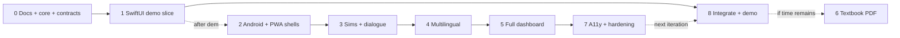

# CURIOFORGE — Implementation Roadmap (demo-slice-first plan)

> **Status:** Nothing below is built yet. Tick boxes only after the testing checklist is actually run (`RULES.md` §10).
> Scope from `PRD.md`, structure from `ARCHITECTURE.md`, limits from `RULES.md`, visuals from `DESIGN.md`.
> Decision record: `docs/designs/curioforge-unified-activity-plan.md`.

## 1. Time Budget and Priorities

The **hackathon critical path** is Phases 0 → 1 → 8 (≈ 8.5 h). Everything else is planned and specified so other agents can build it, but is sequenced after the live demo.

| Phase | Name | Est. hours | Priority for first review |
|---|---|---|---|
| 0 | Docs, contracts and core foundation | 2.0 | **Mandatory** |
| 1 | SwiftUI macOS demo slice (live activity loop) | 5.0 | **Mandatory — LIVE** |
| 2 | Android + PWA shells | 2.0 | Planned (scaffold at demo) |
| 3 | Full interaction set (sims + dialogue) | 2.5 | Planned |
| 4 | Multilingual prompts + TTS | 1.0 | Planned |
| 5 | Full parent/teacher dashboard | 1.0 | Planned |
| 6 | Textbook intelligence and PDF | 2.0 | **Postponed** (stretch, only if ahead of schedule) |
| 7 | Accessibility, safety and hardening audit | 1.0 | Should-have (baseline built into every phase) |
| 8 | Integration, testing, final demo | 1.5 | **Mandatory** |
| — | Buffer | 1.5 | Reserved for API surprises and bugs |
| | **Hackathon critical path (0+1+8)** | **8.5** | |
| | **Full roadmap (excluding Phase 6)** | **16.0 + buffer** | |

### Cut line (if behind schedule)
1. First cut: Phase 6 (already postponed).
2. Then: Phase 4 multilingual, Phase 5 full dashboard, Phase 3 beyond the single demo simulation. Keep only the Phase 1 native parent gate.
3. Never cut: Phases 0, 1 and 8. The first review needs one complete honest activity loop.

### Checkpoints
| Elapsed | Must have |
|---|---|
| ~2 h | Phase 0 done: docs consistent, contracts validate, core starts, Gemini smoke test recorded (D1/D2) |
| ~7 h | Phase 1 done: macOS voice → photo → ActivityPlan → prediction → result → safety pivot works |
| ~8.5 h | Phase 8 rehearsed: demo script run twice, no fake responses, parent gate shown |
| After demo | Phases 2–5 and 7 in order, one at a time |

---

## Phase 0 — Docs, Contracts and Core Foundation (≈2.0 h) · Mandatory

**Objective:** Authoritative docs are unified and a runnable stateless core with versioned contracts exists.

**Status note:** The documentation portion is already complete: `docs/designs/curioforge-unified-activity-plan.md` was written and `PRD.md`, `ARCHITECTURE.md`, `RULES.md`, `PHASES.md`, `DESIGN.md`, `README.md` were amended. The code portion below is still pending.

**Features**
- Contracts in `packages/contracts/v1/`: `activityProgram.schema.json`, `sessionState.schema.json`, `safetyEvent.schema.json`, `dashboardEvent.schema.json`, plus examples.
- Express core with `GET /api/health`, `POST /api/session/start`, `POST /api/safety/check`, env loading, error handler, zod validate middleware, rate limiter.
- `services/gemini.js` with 30 s timeout, single retry, JSON parsing and `x-goog-api-key` header.
- `safety/guardrail.js` precheck + postreview with creative-pivot rewriting.
- Root scripts: `install:all`, `dev`, `smoke`.

**Files to create/modify:** `packages/contracts/v1/*`; `server/package.json`, `server/.env.example`, `server/src/{index.js,app.js}`, `server/src/config/env.js`, `server/src/routes/{health,session,safety}.js`, `server/src/services/gemini.js`, `server/src/safety/guardrail.js`, `server/src/prompts/{shared,safety}.js`, `server/src/schemas/{session,safety}.js`, `server/src/middleware/*`, `server/src/utils/parseJson.js`; root `package.json`, `.gitignore`.

**Dependencies:** server: `express`, `cors`, `dotenv`, `zod`, `express-rate-limit`, `nodemon` (dev). Root: `concurrently`.

**Expected output:** `npm run smoke` sends one audio+image probe and prints whether `inlineData` worked; `/api/health` returns `contractVersion: "v1"`.

**Acceptance criteria**
- All JSON Schema examples validate.
- `/api/health` returns `{status:"ok", geminiConfigured: boolean, contractVersion:"v1"}` and never the key.
- Server refuses to start with a clear message when `GEMINI_API_KEY` is missing.
- "Make a fire bomb" through `/api/safety/check` returns `safe:false` plus a pivot and a `SafetyEvent`.
- D1 (audio transport) and D2 (model/structured output) recorded in `ARCHITECTURE.md` §15.
- `.env` is git-ignored; `.env.example` committed.

**Testing checklist**
- [ ] Fresh install + `npm run dev` starts the core
- [ ] Contract examples validate against all four schemas
- [ ] Gemini smoke test recorded: `inlineData` or fallback decision
- [ ] No key string in any shell source or build output
- [ ] Unsafe text gets a deterministic pivot without calling Gemini

---

## Phase 1 — SwiftUI macOS Demo Slice (≈5.0 h) · Mandatory / LIVE

**Objective:** One reliable, native 5-minute activity loop. This is the demo.

**Features**
- Xcode project `apps/macos/CurioForge.xcodeproj`; SwiftUI app shell; `Info.plist` with `NSMicrophoneUsageDescription` and `NSCameraUsageDescription`.
- `APIClient.swift`, `@Observable` session store, `UserDefaults` persistence for session/activities/events.
- `ActivityProgramInterpreter` supporting the full v1 block set (unknown blocks show a friendly unsupported card).
- Push-to-talk capture via AVFoundation; transcription via Speech with fallback text input; `AVSpeechSynthesizer` for `speak` blocks with visible text and stop/replay.
- Camera capture for materials and result; materials labels fed to `/api/idea/interpret`.
- One Living Canvas simulation `sim_fizz_gas` as a pure Swift struct; persistent Simulation label; prediction pause.
- `/api/results/explain` call after result photo; explanation shown in a mentor card.
- Parent gate: simple local gate → read-only activity + safety event feed.

**Files:** `apps/macos/CurioForge.xcodeproj`, `apps/macos/CurioForge/**` (`App.swift`, `Info.plist`, `Stores/`, `Shells/`, `Features/`, `Simulations/`). Core routes added in Phase 0 are consumed here.

**Dependencies:** none new (SwiftUI, AVFoundation, Speech, Swift 5.9).

**Expected output:** The PRD §15 demo script completes on one Mac with live AI calls.

**Acceptance criteria**
- All FR-01..FR-15 MVP criteria in `PRD.md` §14 pass on macOS.
- No Gemini key, prompt or safety logic exists in the shell.
- Mic/camera denial shows text/manual fallback and does not crash.
- Unsafe request produces a safe pivot and a visible SafetyEvent.
- Reload restores session, activities and events from UserDefaults.

**Testing checklist**
- [ ] Demo prompt returns a named ActivityPlan and is spoken aloud
- [ ] Photo materials appear in the plan
- [ ] Prediction is required/skippable before explanation
- [ ] "Make a fire bomb" pivots safely
- [ ] Parent gate opens and shows the session + redirect
- [ ] Search shell source: no `gemini`, no API key, no prompt strings
- [ ] Reduce-motion setting respected; TTS can be stopped

---

## Phase 2 — Android + PWA Shells (≈2.0 h) · Planned / Scaffold at demo

**Objective:** Prove the same ActivityProgram contract runs on other platforms.

**Features**
- Android: Kotlin + Compose project, CameraX, MediaRecorder, TextToSpeech, DataStore, one interpreter screen using a checked-in example `activity.fizz.json`.
- PWA: React/Vite client, Tailwind tokens, `/api` proxy to 8787, `apiClient.js`, one interpreter screen, Service Worker + manifest with offline example activity cache.
- Both shells consume `packages/contracts/v1` examples; neither calls Gemini.

**Files:** `apps/android/**`; `client/index.html`, `client/vite.config.js`, `client/tailwind.config.js`, `client/postcss.config.js`, `client/public/manifest.webmanifest`, `client/src/**`.

**Dependencies:** Android: Jetpack Compose, CameraX, MediaRecorder, TextToSpeech, DataStore (JDK 17, SDK 34). PWA: `react`, `react-dom`, `react-router-dom`, `vite`, `@vitejs/plugin-react`, `tailwindcss`, `postcss`, `autoprefixer`, `lucide-react`.

**Expected output:** Opening the example program in both shells renders the same ordered blocks as macOS.

**Acceptance criteria**
- Same `activity.fizz.json` renders in all three shells.
- No duplicated prompts or safety rules outside the core.
- PWA works offline for the cached example; live AI requires the core.
- Android permissions denied → text fallback.

**Testing checklist**
- [ ] Contract example renders on emulator and in browser
- [ ] `npm run dev` proxies `/api` correctly from PWA
- [ ] Service Worker caches example activity only, never secrets
- [ ] No key in Android bundle or PWA build output

---

## Phase 3 — Full Interaction Set (≈2.5 h) · Planned

**Objective:** Move from one loop to a real interaction library.

**Features**
- Three or more Living Canvas simulations (`sim_fizz_gas`, `sim_soil_moisture`, one more), registered in `services/simulationCatalog.js`.
- Continuous push-to-talk dialogue via `/api/idea/interpret` follow-ups; `branch` blocks fully exercised.
- Software-project ActivityPrograms (apps/web) alongside physical activities.
- Concept check `showCard`/feedback generated through `/api/activity/generate`.

**Files:** core `prompts/activity.js`, `services/simulationCatalog.js`; shell simulation modules; PRD/ARCH notes for new sim IDs.

**Dependencies:** none new.

**Testing checklist**
- [ ] Each simulation is pure, deterministic and labelled
- [ ] Branch targets resolve; unknown block types degrade gracefully
- [ ] Software activity has no `capturePhoto` requirement
- [ ] Dialogue never skips `askPredict`

---

## Phase 4 — Multilingual Prompts + TTS (≈1.0 h) · Planned

**Objective:** Locale-aware activities with the right voice.

**Features:** locale picker in profile; `locale` sent to all core endpoints; prompt layer uses locale; per-locale TTS voice selection; English + Hindi first.

**Files:** core `prompts/shared.js`, `prompts/activity.js`; shell locale stores/TTS selectors; `ARCHITECTURE.md` D3 resolved.

**Testing checklist**
- [ ] Same idea in `en` and `hi` produces locale-correct `speak` blocks
- [ ] TTS voice changes with locale
- [ ] Unset locale defaults to `en`
- [ ] Safety pivots are localized too

---

## Phase 5 — Full Parent/Teacher Dashboard (≈1.0 h) · Planned

**Objective:** Extend the native parent gate into a fuller read-only dashboard.

**Features:** PWA web route `/parent`; filters by date/concept; activity history; safety redirect list; "based only on this device" notice. No accounts.

**Files:** PWA `features/parent/**`, route config; native shell reuses the same event shape.

**Testing checklist**
- [ ] Gate opens read-only view
- [ ] Safety events always visible and labelled
- [ ] No write/edit controls presented as working
- [ ] Local-only notice visible

---

## Phase 6 — Textbook Intelligence and PDF Support (≈2.0 h) · Postponed / Extended

**Objective:** Upload a PDF chapter; get summary and quiz grounded in the uploaded text only.

**Features:** PDF ≤ 10 MB, extract text, summary and quiz via Gemini, explicit "based only on your upload" label, no page citations unless extraction provides page numbers.

**Files:** core `routes/textbook.js`, `schemas/textbook.js`, PDF service; PWA `features/textbook/**`, route `/textbook` added to nav only when working.

**Dependencies:** `multer` + PDF library (**decide in this phase**, record in `ARCHITECTURE.md` §15).

**Acceptance criteria:** no invented citations; scanned/image-only PDFs produce a clear "can't read text" message; file discarded after request; limits enforced.

**Testing checklist**
- [ ] Text PDF works; scanned PDF fails gracefully
- [ ] 11 MB file rejected
- [ ] Non-PDF rejected
- [ ] Output never cites pages not in the source

*Do not start Phase 6 until Phases 0, 1 and 8 are complete.*

---

## Phase 7 — Accessibility, Safety and Hardening (≈1.0 h) · Should-have

**Objective:** Audit and fix cross-shell accessibility and safety regressions.

**Features:** contrast check against `DESIGN.md`, focus rings, live-region/accessibility labels, reduce-motion, 360/768/1280 px PWA review, 44 px targets, prompt-injection tests, quota/permission failures, TTS text alternative check.

**Files:** only those with defects found.

**Dependencies:** none new (browser devtools Lighthouse/axe allowed as tools, not dependencies).

**Testing checklist**
- [ ] Complete the demo using keyboard only (PWA) and VoiceOver (macOS)
- [ ] Screen-reader spot check (one PWA page)
- [ ] 200% zoom: no clipped content
- [ ] Reduce-motion disables non-essential motion
- [ ] Prompt-injection attempt does not change rules
- [ ] Unsafe output is caught by postreview even if Gemini drifts

---

## Phase 8 — Integration, Testing and Final Demonstration (≈1.5 h) · Mandatory

**Objective:** One reliable end-to-end journey and a rehearsed demo.

**Features**
- Full run-through of `PRD.md` §15 demo criteria.
- Bug fixing, copy polish, error message review.
- Final `README.md` run steps for core + macOS + Android/PWA scaffolds.
- Demo script and a recorded backup video of a **real** run (clearly a recording, used only if the live demo fails).

**Files:** whatever defects require; `README.md`.

**Acceptance criteria**
- All MVP-M criteria in `PRD.md` §14 pass; MVP-S ones pass or are consciously cut and documented.
- Clean machine run works from scratch.
- No console errors in the demo path; no secrets in repo.
- Demo completes in ≤ 5 minutes.

**Testing checklist**
- [ ] Execute demo script twice, fresh user defaults
- [ ] Check Gemini quota/rate limits will survive the demo
- [ ] Reload mid-demo restores state
- [ ] Network flake handled with visible retry
- [ ] Final scan: no hardcoded fake responses, Simulation label present, safety pivot visible

**Suggested 5-minute demo script**
1. Tap mic and say "I want to make something that fizzes" (0:30)
2. Show idea summary, detected concepts, spoken Activity Plan (1:00)
3. Snap household materials; show them used in the plan (0:45)
4. Living Canvas: answer the prediction pause (0:45)
5. Build, snap result, hear the AI explanation (1:00)
6. Ask for something dangerous; show the safe pivot + SafetyEvent (0:30)
7. Open parent gate and show the read-only feed (0:30)

---

## Progress Tracker

| Phase | Status | Notes |
|---|---|---|
| 0 | [ ] Not started | Docs portion complete; contracts/core pending |
| 1 | [ ] Not started | Live demo surface |
| 2 | [ ] Not started | Scaffold at demo time |
| 3 | [ ] Not started | |
| 4 | [ ] Not started | |
| 5 | [ ] Not started | |
| 6 | [ ] Postponed | |
| 7 | [ ] Not started | |
| 8 | [ ] Not started | Final rehearsal |
