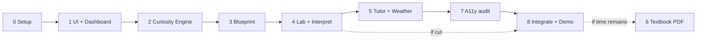

# CURIOFORGE — Implementation Roadmap (18-hour plan)

> **Status:** Nothing below is built yet. Tick boxes only after the testing checklist is actually run (`RULES.md` §10).
> Scope from `PRD.md`, structure from `ARCHITECTURE.md`, limits from `RULES.md`, visuals from `DESIGN.md`.

## 1. Time Budget and Priorities

| Phase | Name | Est. hours | Priority for first review |
|---|---|---|---|
| 0 | Setup and foundation | 1.5 | **Mandatory** |
| 1 | UI foundation and dashboard | 2.0 | **Mandatory** |
| 2 | AI Curiosity Engine | 3.0 | **Mandatory** |
| 3 | Invention Blueprint Generator | 2.5 | **Mandatory** |
| 4 | Interactive STEM Lab (soil moisture) + results interpretation | 3.0 | **Mandatory** |
| 5 | Personalised tutor (concept explainer) + Open-Meteo | 1.5 | Should-have |
| 6 | Textbook intelligence and PDF | 2.0 | **Postponed** (stretch, only if ahead of schedule) |
| 7 | Accessibility and responsive polish | 1.0 | Should-have (baseline a11y is built into every phase; this is the audit) |
| 8 | Integration, testing, final demo | 2.0 | **Mandatory** |
| — | Buffer | 1.5 | Reserved for API surprises and bugs |
| | **Total (excluding Phase 6)** | **18.0** | |

### Cut line (if behind schedule)
1. First cut: Phase 6 (already postponed).
2. Then: tutor feedback (`/api/tutor/feedback`), then Open-Meteo (Phase 5 weather), keeping the concept explainer.
3. Never cut: Phases 0–4 and 8. The first review needs one complete honest journey.

### Checkpoints
| Elapsed | Must have |
|---|---|
| ~3.5 h | Phases 0–1 done: app shell and dashboard run |
| ~9.5 h | Phases 2–3 done: idea → blueprint works with live Gemini |
| ~12.5 h | Phase 4 done: simulation and interpretation work |
| ~16.5 h | Phases 5, 7, 8 done or consciously cut |

---

## Phase 0 — Project Setup and Foundation  (≈1.5 h) · Mandatory

**Objective:** A running monorepo skeleton where client and server both start and talk to each other.

**Features**
- Repo structure per `ARCHITECTURE.md` §14.
- Vite + React client with Tailwind configured to `DESIGN.md` tokens.
- Express server with `GET /api/health`, env loading, error handler, zod validate middleware, rate limiter.
- Vite proxy `/api` → `http://localhost:8787`.
- Root script running both with one command.

**Files to create/modify:** root `package.json`, `.gitignore`, `README.md` (run instructions only); `client/` (`index.html`, `vite.config.js`, `tailwind.config.js`, `postcss.config.js`, `src/main.jsx`, `src/App.jsx`, `src/index.css`); `server/` (`package.json`, `.env.example`, `src/index.js`, `src/app.js`, `config/env.js`, `routes/health.js`, `middleware/*`).

**Dependencies:** client: `react`, `react-dom`, `react-router-dom`, `vite`, `@vitejs/plugin-react`, `tailwindcss`, `postcss`, `autoprefixer`, `lucide-react`. Server: `express`, `cors`, `dotenv`, `zod`, `express-rate-limit`, `nodemon` (dev). Root: `concurrently`.

**Expected output:** `npm run dev` shows a blank styled page that displays "Server: OK" fetched from `/api/health`.

**Acceptance criteria**
- Client on `localhost:5173`, server on `8787`.
- `/api/health` returns `{status:"ok", geminiConfigured: boolean}` and never the key.
- Server refuses to start with a clear message when `GEMINI_API_KEY` is missing (or health reports `false`; decide and document).
- Tailwind classes using design tokens render (dark background visible).
- `.env` is git-ignored; `.env.example` committed.

**Testing checklist**
- [ ] Fresh clone + `npm install` + `npm run dev` works
- [ ] Health call through proxy succeeds from browser
- [ ] No key string in `client/` bundle (search build output)
- [ ] Open Decisions D1 and D3 recorded in `ARCHITECTURE.md` with the chosen values

---

## Phase 1 — UI Foundation and Dashboard  (≈2.0 h) · Mandatory

**Objective:** Premium app shell and reusable UI primitives, plus the Dashboard.

**Features**
- `AppShell`, `Sidebar` (collapses to icon rail on `lg`, bottom nav on mobile), `TopBar`.
- UI primitives: `Button`, `Card`, `Chip`, `Badge`, `Input`, `Textarea`, `Select`, `Spinner`, `ErrorState`, `EmptyState`.
- `ProjectContext` + `useLocalStorage` + `useAsync`.
- Dashboard: hero input "What are you curious about?", recent projects (empty state), profile chip with grade band selector.
- Router with routes for pages (placeholders only for pages built in later phases are **hidden from nav** until built).

**Files:** `client/src/components/ui/*`, `components/layout/*`, `context/ProjectContext.jsx`, `hooks/*`, `lib/ids.js`, `lib/apiClient.js` (skeleton), `pages/DashboardPage.jsx`, `features/dashboard/*`, `App.jsx`.

**Dependencies:** none new.

**Expected output:** a polished dark dashboard; submitting the hero input creates a project and navigates to `/create/:id` (page may show a stub until Phase 2).

**Acceptance criteria**
- Matches palette, typography and spacing in `DESIGN.md`.
- Grade band and nickname persist after reload.
- Recent projects list reads from LocalStorage; delete works.
- Layout usable at 360 px, 768 px and 1280 px.

**Testing checklist**
- [ ] Reload keeps profile and projects
- [ ] Corrupted LocalStorage value does not crash the app
- [ ] Keyboard-only navigation of sidebar and hero input
- [ ] Empty state visible with zero projects

---

## Phase 2 — AI Curiosity Engine  (≈3.0 h) · Mandatory

**Objective:** A mentor conversation that builds an Idea Board and detects STEM concepts, using live Gemini.

**Features**
- `services/gemini.js` (`generateJson`, timeout, single retry, safe error mapping).
- `prompts/mentor.js`, `schemas/curiosity.js`, `routes/curiosity.js` → `POST /api/curiosity/chat`.
- Client `/create/:projectId`: `ChatPanel`, `MessageBubble`, `FollowUpChips`, `IdeaBoard` (goal, user, constraints, concepts, open questions).
- "Generate blueprint" button visible after first full exchange; highlighted when `stage = ready_for_blueprint`.

**Files:** server: `services/gemini.js`, `prompts/{shared,mentor}.js`, `schemas/curiosity.js`, `routes/curiosity.js`, `utils/parseJson.js`, `app.js`. Client: `features/curiosity/*`, `pages/CreatePage.jsx`, `lib/apiClient.js`.

**Dependencies:** none new.

**Expected output:** entering the demo prompt returns relevant follow-up questions; Idea Board shows soil moisture/sensors-type concepts.

**Acceptance criteria**
- Matches `/api/curiosity/chat` contract in `ARCHITECTURE.md` §15.
- Invalid AI JSON is retried once, then shows a retry UI (never raw output).
- Conversation persists in the project.
- Student text > 1000 chars or > 20 messages is rejected with `VALIDATION_ERROR` (client trims history sensibly).
- Mentor replies contain a "why" and 1–3 follow-ups; no unsafe suggestions.

**Testing checklist**
- [ ] Demo prompt: follow-ups are relevant (crop, water source, budget, power)
- [ ] Unsafe prompt (e.g. mains-voltage device) gets a redirect to a safer idea
- [ ] Prompt-injection attempt ("ignore your rules") does not change behaviour
- [ ] Kill server mid-request → error state with retry, input preserved
- [ ] Missing/invalid API key → friendly error, no key in response
- [ ] Gemini model/output-schema assumption (D1) verified and recorded

---

## Phase 3 — Invention Blueprint Generator  (≈2.5 h) · Mandatory

**Objective:** Turn the conversation into a structured, readable invention blueprint.

**Features**
- `POST /api/blueprint/generate` with schema validation and sanity checks (`ARCHITECTURE.md` §9).
- Blueprint viewer: summary, concepts (links to Learn when built), how it works, components with cost-tier chips and alternatives, numbered build steps with "why" and safety callouts, test plan, improvements, safety, limitations, thinking questions.
- Regenerate button; blueprint stored in project.
- Link to lab when `labId = soil_moisture`.

**Files:** server: `prompts/blueprint.js`, `schemas/blueprint.js`, `routes/blueprint.js`. Client: `features/blueprint/*`, `pages/BlueprintPage.jsx`.

**Dependencies:** none new.

**Expected output:** demo scenario yields a full blueprint in under 30 s.

**Acceptance criteria**
- All FR-06..FR-09 criteria in `PRD.md` §14.
- No price figures in output; cost tiers only.
- Hardware blueprints always include supervision warning(s).
- Blueprint reloads from LocalStorage without a new AI call.

**Testing checklist**
- [ ] Demo scenario blueprint has ≥5 steps, ≥2 tests, alternatives for every component
- [ ] A software idea (e.g. "app to track homework") yields `mode: "software"` and `labId: null`
- [ ] Schema failure path shows retry
- [ ] Printing/zoom at 200% remains readable

---

## Phase 4 — Interactive STEM Lab and Results Interpretation  (≈3.0 h) · Mandatory

**Objective:** A working soil-moisture simulation and AI explanation of results.

**Features**
- `lib/simulation/soilMoistureModel.js` per `ARCHITECTURE.md` §10 (pure, unit-checkable).
- `SoilMoistureLab`: `ControlPanel` (soil type, days, ET, rain, crop factor, schedule, threshold/target), `MoistureChart` (custom SVG, both strategies, stress line, data-table toggle), `ResultsPanel` (water used, saved %, stress days, wasted).
- "Predict first" textbox → "Explain my results" → `POST /api/results/interpret`.
- Persistent "Simulation — simplified model" label.

**Files:** client: `lib/simulation/soilMoistureModel.js`, `features/lab/*`, `pages/LabPage.jsx`. Server: `prompts/results.js`, `schemas/results.js`, `routes/results.js`.

**Dependencies:** none new.

**Expected output:** moving a slider updates the chart instantly; sensor strategy typically shows lower water use than the fixed schedule under default settings; AI explanation references the exact numbers.

**Acceptance criteria**
- FR-10 and FR-11 in `PRD.md` §14.
- Model deterministic: same inputs → same outputs.
- Moisture never < 0 or > 100; water balance matches formulas in §10.
- Interpretation never alters or recomputes numbers; includes caveats and ≥2 improvements.
- Lab usable without any AI call (interpretation optional).

**Testing checklist**
- [ ] Manual calc for a 3-day case matches model output
- [ ] Edge cases: 0 rain, heavy rain (excess/wasted > 0), clay vs sand
- [ ] Strategy A using 0 water → `waterSavedPct` is `null`, UI shows "n/a"
- [ ] Chart readable at 360 px; data table alternative present
- [ ] Interpretation failure leaves lab fully usable

---

## Phase 5 — Personalised Tutor and Open-Meteo  (≈1.5 h) · Should-have

**Objective:** Concept explainer adapted to grade band, and real forecast feeding the lab.

**Features**
- `POST /api/tutor/explain` (and `/api/tutor/feedback` as stretch inside this phase).
- `/learn` concept list from project concepts; concept page with explanation, analogy, key terms, check question, feedback.
- `services/openMeteo.js`, `GET /api/weather/geocode`, `GET /api/weather/forecast`, 10-min cache.
- `WeatherPanel` in the lab: city search → forecast → "Use this forecast" sets rain/ET for up to 7 days; shows source and fetch time.

**Files:** server: `prompts/tutor.js`, `schemas/{tutor,weather}.js`, `routes/{tutor,weather}.js`, `services/openMeteo.js`. Client: `features/learn/*`, `pages/LearnPage.jsx`, `features/lab/WeatherPanel.jsx`.

**Dependencies:** none new.

**Expected output:** "Soil moisture" and "Sensors" cards open from the blueprint; searching "Bengaluru" fills the lab with real forecast numbers.

**Acceptance criteria**
- FR-05 and FR-12 in `PRD.md` §14.
- Explanations differ visibly across grade bands.
- Weather failure never inserts fake values; manual inputs still work.
- D4 (Open-Meteo variables/terms) verified and recorded.

**Testing checklist**
- [ ] Same concept for 6–8 vs 11–12 differs in vocabulary
- [ ] Unknown city → friendly "no results"
- [ ] Offline/blocked Open-Meteo → error notice, lab still works
- [ ] Forecast values match Open-Meteo's own site for the same coordinates (spot check)

---

## Phase 6 — Textbook Intelligence and PDF Support  (≈2.0 h) · Postponed / Extended

**Objective:** Upload a PDF chapter; get summary and quiz grounded in the uploaded text only.

**Features:** upload (PDF ≤ 10 MB), extract text, summary and quiz via Gemini, explicit "based only on your upload" label, no page citations unless extraction provides page numbers.

**Files:** server `routes/textbook.js`, `schemas/textbook.js`, PDF handling in a new service; client `features/textbook/*`, route `/textbook` (added to nav only when working).

**Dependencies:** `multer` + a PDF library (**decide D2 first**, record in `ARCHITECTURE.md`).

**Expected output:** a 5–10 page chapter produces a faithful summary and 5 questions.

**Acceptance criteria:** no invented citations; scanned/image-only PDFs produce a clear "can't read text" message; file discarded after request; limits enforced.

**Testing checklist**
- [ ] Text PDF works; scanned PDF fails gracefully
- [ ] 11 MB file rejected
- [ ] Non-PDF rejected
- [ ] Output never cites pages not in the source

*Do not start Phase 6 until Phases 0–4 and 8 are complete.*

---

## Phase 7 — Accessibility and Responsive Design  (≈1.0 h) · Should-have

**Objective:** Audit and fix accessibility and layout issues across all built pages.

**Features:** contrast check against `DESIGN.md` palette, focus rings, aria-live regions, label audit, reduced-motion, 360/768/1280 px review, touch target sizes, chart text alternative check.

**Files:** only those with defects found.

**Dependencies:** none new (browser devtools Lighthouse/axe extension allowed as tools, not dependencies).

**Acceptance criteria:** meets `PRD.md` §12 A-01..A-09; no critical axe/Lighthouse accessibility violations on Dashboard, Create, Blueprint, Lab.

**Testing checklist**
- [ ] Complete the demo using keyboard only
- [ ] Screen-reader spot check (one page)
- [ ] 200% zoom: no clipped content
- [ ] `prefers-reduced-motion` disables non-essential motion

---

## Phase 8 — Integration, Testing and Final Demonstration  (≈2.0 h) · Mandatory

**Objective:** One reliable end-to-end journey and a rehearsed demo.

**Features**
- Full run-through of `PRD.md` §15 demo criteria.
- Bug fixing, copy polish, error message review.
- Update `README.md` with run steps and env setup.
- Demo script and a recorded backup video of a **real** run (clearly a recording, used only if the live demo fails).

**Files:** whatever defects require; `README.md`.

**Dependencies:** none new.

**Acceptance criteria**
- All MVP-M criteria in `PRD.md` §14 pass; MVP-S ones pass or are consciously cut and documented.
- Clean browser profile run works from scratch.
- No console errors in the demo path; no secrets in repo.
- Demo completes in ≤ 5 minutes.

**Testing checklist**
- [ ] Execute demo script twice, fresh browser profile
- [ ] Check Gemini quota/rate limits will survive the demo (don't burn requests testing right before)
- [ ] Reload mid-demo restores state
- [ ] Network flake handled with visible retry
- [ ] Final scan: no hardcoded fake responses in UI paths; labels and disclaimers present

**Suggested 5-minute demo script**
1. Dashboard → type the farmers-and-water prompt (0:30)
2. Follow-up answers and Idea Board (1:00)
3. Concept cards: soil moisture, sensors (0:45)
4. Generate blueprint; show components, alternatives, safety (1:15)
5. Lab: tweak inputs, show saved water %, optional real forecast (1:00)
6. Explain my results; close on improvements (0:30)

---

## Progress Tracker

| Phase | Status | Notes |
|---|---|---|
| 0 | [ ] Not started | |
| 1 | [ ] Not started | |
| 2 | [ ] Not started | |
| 3 | [ ] Not started | |
| 4 | [ ] Not started | |
| 5 | [ ] Not started | |
| 6 | [ ] Postponed | |
| 7 | [ ] Not started | |
| 8 | [ ] Not started | |
