# CURIOFORGE — Product Requirements Document (PRD)

> **Tagline:** Turning Curiosity into Invention
> **Document status:** Planning. **Nothing described here is implemented yet.** Every feature is `[PLANNED]` until its phase in `PHASES.md` is ticked off.
> **Decision record:** `docs/designs/curioforge-unified-activity-plan.md` (approved 2026-11-17) supersedes the two older drafts and explains the re-scope.
> **Companion docs:** `ARCHITECTURE.md` (how), `RULES.md` (boundaries), `PHASES.md` (order of work), `DESIGN.md` (look and feel).
> **Source of truth for:** product scope, user needs, acceptance criteria. If another document conflicts on *scope*, this one wins.

## Legend

| Tag | Meaning |
|---|---|
| `[MVP-M]` | **Must** work in the hackathon demo |
| `[MVP-S]` | **Should** work; first to be cut if time runs short |
| `[PHASE 2]` | Planned after the live demo; scaffold/interpreter work |
| `[PHASE 3]` | Planned after platform shells exist |
| `[PHASE 4]` | Planned after the core interaction set |
| `[EXT]` | Extended version, after the MVP |
| `[LONG]` | Long-term vision, significant development |
| `[PLANNED]` | Designed, not yet built (applies to everything today) |

---

## 1. Project Overview

CURIOFORGE is an inclusive, AI-guided STEM invention platform for **primary students, ages 7–8 (Grades 2–3)**. It turns a spoken, half-formed idea plus a photo of household materials into a practical activity the child can actually do — then explains the science from the result they made.

Journey: **Curiosity → Speak → Snap materials → Activity Plan → Predict → Build → Snap result → Explain → Share with an adult.**

The AI acts as a **mentor, not an answer machine**: it asks questions, prompts a prediction, explains the *why*, and makes the student decide. The product is the **closed build loop**, not a chat companion.

The architecture thesis is a shared core that emits a versioned, declarative **ActivityProgram v1** ("bytecode" for interactions), interpreted by thin platform shells. This is what lets the same activity run on SwiftUI macOS, Android, and a PWA.

| Journey | Purpose | Hackathon coverage |
|---|---|---|
| **Create STEM (Activity Loop)** | Idea → materials → Activity Plan → build → result → explanation | Core of the MVP, live on macOS |
| **Learn STEM** | Concept explanations, tutor feedback, Living Canvas | Concept cards + one simulation in MVP |
| **Supervise** | Parent/teacher sees activity history and safety redirects | Read-only parent gate in MVP |

## 2. Problem Statement

- Children aged 7–8 have ideas but cannot yet type them fluently; a text box is a barrier.
- Voice-first kids' AI products are crowded, but most stop at "warm answer". The build step is missing.
- Existing household-activity resources give finished projects to copy, which teaches little.
- Camera object-ID apps name things; they do not turn what is on the table into a personalized experiment.
- Generic AI chatbots are unsafe for this age, give long unverified answers, and rarely flag hazards.
- Parents and teachers want visibility without surveillance.

## 3. Target Users and Personas

| Persona | Description | Needs |
|---|---|---|
| **Riya, 7 (primary)** | Grade 2, pre-fluent reader, shared family Mac, limited adult supervision | Big mic button, voice and read-aloud, short steps, cheap household materials, encouragement |
| **Parent / Ms. Rao (secondary)** | Parent or science teacher mentoring one child or a small club | Safe, explainable output; activity history; safety redirects she can supervise |
| **Hackathon judges** | Evaluate in minutes | One clear, working, honest end-to-end loop plus a credible multi-platform architecture |

MVP is designed for **Riya** and the supervising adult. Older grade bands and classroom mode are `[LONG]`.

## 4. Proposed Solution

1. **Voice-first activity shell** — a big mic, a camera button, and an Activity Plan card; text is a fallback, not the primary input.
2. **Idea interpretation** — the core turns the spoken idea into a summary, detected concepts, and a pre-activity safety check.
3. **ActivityProgram v1** — a schema-valid, ordered set of blocks the shell interprets: `speak`, `listen`, `showCard`, `askPredict`, `simulate`, `capturePhoto`, `supervisionNote`, `explainResult`, `branch`.
4. **Living Canvas** — a clearly labelled, client-side simulation the child can touch or talk to, with a prediction pause before results.
5. **Result explanation** — the child snaps what they built; the core explains the observed science using their own result.
6. **Deterministic safety guardrail** — hazard detection and creative-pivot rewriting before and after every AI call; never prompt-only.
7. **Parent gate** — a read-only feed of what was asked, built, and redirected.
8. **Thin shells** — SwiftUI macOS is the live demo; Android and PWA interpreters are scaffolded and phased.
9. **Multilingual prompts and TTS** — planned in Phase 4, English first, then a configurable second locale.

## 5. Product Goals

| # | Goal | Measure (demo-level) |
|---|---|---|
| G1 | Deliver one complete, honest child journey | Demo loop runs end to end with live AI calls |
| G2 | Build understanding, not just output | Every activity includes a prediction prompt and a "why" explanation |
| G3 | Work with what is actually on the table | Photo-derived materials are used by the ActivityPlan |
| G4 | Safe by default | Deterministic redirect on unsafe requests; supervision notes where relevant |
| G5 | Inclusive for pre-fluent readers | Voice input + read-aloud + 44 px+ targets + plain age-7 language |
| G6 | Prove the architecture | One ActivityProgram renders in the macOS shell; contract documented for other shells |
| G7 | Give adults visibility without surveillance | Parent-gated, read-only event feed |

## 6. Core User Journeys

### J1 — "Make something that fizzes" (primary demo) `[MVP-M]`

```mermaid
flowchart LR
  A[Child taps mic and speaks idea] --> B[Core: idea summary + concepts + safety precheck]
  B --> C{Unsafe?}
  C -- yes --> D[Creative pivot: safe fizz variant]
  C -- no --> E[ActivityProgram v1 generated]
  D --> E
  E --> F[macOS shell speaks plan and shows cards]
  F --> G[Child predicts in Living Canvas]
  G --> H[Child builds with photographed materials]
  H --> I[Child snaps result]
  I --> J[Core explains observed science]
  J --> K[Parent gate shows session + safety events]
```

### J2 — Learn a concept `[MVP-S]`
Child opens a concept card (for example "fizz / gas"), hears a short explanation, answers a check question by voice or tap, and gets encouraging feedback.

### J3 — Learn from a textbook `[EXT]`
Adult uploads a textbook chapter PDF; the app summarises and quizzes from the *uploaded text only*.

### J4 — Return to an activity `[MVP-M]`
Child or parent reopens a saved activity from local storage on the same device.

### J5 — Adult review `[MVP-M]`
Parent passes a simple gate and sees a read-only list of activities, concepts, and safety redirects.

## 7. Functional Requirements

| ID | Requirement | Priority |
|---|---|---|
| FR-01 | First-use profile: nickname optional, `ageBand` includes `7-8`, stored locally | MVP-M |
| FR-02 | Activity shell with big mic, camera, read-aloud, recent activities | MVP-M |
| FR-03 | Voice idea capture via AVFoundation on macOS (push-to-talk); text fallback | MVP-M |
| FR-04 | Camera capture of materials and result; permission-denied path is non-breaking | MVP-M |
| FR-05 | `/api/idea/interpret` returns idea summary, detected concepts, and a pre-safety verdict | MVP-M |
| FR-06 | `/api/activity/generate` returns schema-valid `ActivityProgram` v1 | MVP-M |
| FR-07 | macOS interpreter supports the v1 block set listed in §4 | MVP-M |
| FR-08 | `speak` blocks are read aloud via `AVSpeechSynthesizer`, with on-screen text | MVP-M |
| FR-09 | One Living Canvas simulation, client-side, labelled "Simulation — simplified model" | MVP-M |
| FR-10 | `askPredict` pauses for a prediction before `explainResult` | MVP-M |
| FR-11 | `/api/results/explain` uses the captured result and the child's prediction | MVP-M |
| FR-12 | Deterministic hazard guardrail + creative-pivot rewriter before and after AI; emits `SafetyEvent` | MVP-M |
| FR-13 | Parent gate and read-only activity/safety feed | MVP-M |
| FR-14 | Local persistence per platform: UserDefaults / DataStore / LocalStorage | MVP-M |
| FR-15 | Loading, empty, error, permission-denied and retry states on every async feature | MVP-M |
| FR-16 | Locale-aware prompts and per-locale TTS voices | PHASE 4 |
| FR-17 | Android shell: Kotlin + Compose, CameraX, MediaRecorder, TextToSpeech, DataStore | PHASE 2 |
| FR-18 | PWA shell: React/Vite, Service Worker, offline activity cache, install prompt | PHASE 2 |
| FR-19 | Continuous push-to-talk dialogue and 3+ Living Canvas simulations | PHASE 3 |
| FR-20 | Textbook PDF upload, summary and quiz | EXT |
| FR-21 | More simulations (circuits, plant growth, etc.) | EXT |
| FR-22 | Real-world data grounding (e.g. Open-Meteo) | MVP-S / EXT |
| FR-23 | Software-activity programs (apps/web) beyond physical builds | PHASE 3 |

**Honesty rule for the demo:** all AI content is live from Gemini; the Living Canvas is a simplified model and is labelled as such. No hardcoded responses are presented as live.

## 8. Non-Functional Requirements

| ID | Requirement |
|---|---|
| NFR-01 | AI responses show a loading state within 200 ms; typical AI wait target ≤ 15 s; hard timeout 30 s with retry |
| NFR-02 | Living Canvas runs fully client-side and responds to input in < 100 ms |
| NFR-03 | Demo on macOS 13+ with Xcode 15+/Swift 5.9; PWA supports current Chrome, Edge, Firefox, Safari; Android scaffold targets SDK 34 |
| NFR-04 | No API keys or secrets in any client shell, `VITE_*` variable, bundle, log or repo |
| NFR-05 | All AI JSON validated against zod schemas before reaching any shell |
| NFR-06 | WCAG 2.1 AA target plus age-7 usability: ≥ 44 px targets, read-aloud, text alternative for voice |
| NFR-07 | `npm run install:all` + documented native setup brings up core and PWA; macOS instructions are copy-pasteable |
| NFR-08 | Free-tier friendly: no paid infrastructure required for the demo |
| NFR-09 | `ActivityProgram` schema is versioned (`v1`) and unchanged by shell-specific rendering |
| NFR-10 | Missing/denied microphone or camera permission shows a clear fallback, never a crash |

## 9. MVP Scope (hackathon build)

**Live in the demo:** Phases 0, 1, 8 — core endpoints, guardrail, contracts, SwiftUI macOS shell, one ActivityProgram loop, one Living Canvas, parent gate.

**Planned but not live at demo:** Android and PWA interpreters (Phase 2), broader interaction set (Phase 3), multilingual (Phase 4), full dashboard (Phase 5), textbook PDF (Phase 6/EXT).

The core accepts any age-appropriate idea, but only one Living Canvas simulation ships in the demo; other ideas still get a complete Activity Plan with a "no simulation for this topic yet" state.

## 10. Features Excluded from MVP

| Feature | Tag | Reason |
|---|---|---|
| Textbook PDF intelligence | EXT (Phase 6, stretch) | Needs parsing, chunking, grounding |
| Multiple Living Canvas simulations | PHASE 3 / EXT | Each is its own model + UI |
| Continuous push-to-talk dialogue | PHASE 3 | Push-to-talk is enough for demo |
| Non-English locales | PHASE 4 | English first, then one configurable locale |
| Full Android and PWA builds | PHASE 2 | Scaffold + one screen at demo time |
| Accounts, cloud sync, database | LONG | Local storage suffices |
| Classroom mode, multi-child roster | LONG | Needs accounts |
| Real hardware code generation and flashing | EXT | Safety and verification burden |
| Streaming AI responses | EXT | Not needed for demo |
| AR/3D model viewer | LONG | |
| Community sharing and gallery | LONG | Moderation burden |

## 11. Future Enhancements

- `[PHASE 2]` Android + PWA ActivityProgram interpreters.
- `[PHASE 3]` Living Canvas library, continuous dialogue, software activities.
- `[PHASE 4]` Multilingual prompts and TTS: English + one more locale, then expand.
- `[PHASE 5]` Full parent/teacher dashboard with filters and activity history.
- `[EXT]` Textbook intelligence with page-referenced answers, quizzes and flashcards.
- `[EXT]` Additional simulations and child-entered real sensor readings.
- `[LONG]` Accounts, teacher tools, portfolios, supervised classroom flows.
- `[LONG]` Component price lookup via a real data source (never AI-guessed prices).

## 12. Accessibility Requirements

| ID | Requirement |
|---|---|
| A-01 | Body text contrast ≥ 4.5:1, large text and UI components ≥ 3:1 (palette in `DESIGN.md`) |
| A-02 | Full keyboard operation with visible focus rings; logical tab order; voice is never the only input |
| A-03 | Semantic controls, labelled inputs, `aria-live`-equivalent announcements for AI responses and loading status |
| A-04 | Respect `prefers-reduced-motion` / platform reduce-motion setting |
| A-05 | Minimum 44×44 px touch/click targets for primary controls |
| A-06 | Plain-language writing: short sentences, jargon defined on first use, age-band adjustment (`7-8` default) |
| A-07 | Never convey meaning by colour alone (icons/text accompany status colours) |
| A-08 | Simulations have text summaries and a data-table alternative |
| A-09 | Every spoken `speak` block is also visible as on-screen text; every voice prompt has a tap fallback |
| A-10 | Microphone/camera denial, quiet audio and failed transcription show a readable text alternative |

## 13. Safety and Responsible AI Requirements

| ID | Requirement |
|---|---|
| S-01 | Living Canvas views show a persistent "Simulation — simplified model" label |
| S-02 | Physical steps include supervision warnings ("Do this with a teacher or adult") where tools are involved |
| S-03 | Deterministic guardrail runs **before and after** the AI; hazardous requests become a safe creative pivot, never a refusal wall |
| S-04 | AI never suggests mains voltage, lithium battery abuse, open flames, hazardous chemicals or dangerous experiments |
| S-05 | AI output is framed as guidance, never guaranteed fact; uncertainty and limits are stated |
| S-06 | No invented citations or textbook references |
| S-07 | Cost information is a **tier** (low/medium/high), not a fabricated price |
| S-08 | No collection of sensitive personal data; nickname optional; no real names required |
| S-09 | AI-generated code is never executed by the app |
| S-10 | Mentor prompts the child to predict, decide and justify before revealing results |
| S-11 | Camera guidance asks for materials/objects only — never people or identifying documents |
| S-12 | Every safety redirect is recorded as a `SafetyEvent` and is visible in the parent gate |

## 14. Acceptance Criteria for MVP Features

| Feature | Acceptance criteria |
|---|---|
| **FR-01 Profile** | First use lets a child pick age 7–8 and optional nickname; persists after reload; skipping uses the 7–8 default. |
| **FR-02 Shell** | Big mic and camera controls are visible with labels; recent activities show empty state when none. |
| **FR-03/04 Capture** | Speech and a photo can be captured on the demo Mac; denial of either permission shows a usable text/manual fallback. |
| **FR-05 Idea interpretation** | Spoken idea returns a named summary, ≥1 detected concept and a `safetyVerdict` in under 30 s or a retry appears. |
| **FR-06/07 ActivityProgram** | Response validates against `ActivityProgram.v1` and renders as ordered blocks; invalid JSON is never shown. |
| **FR-08 Read-aloud** | Every `speak` block is spoken and shown as text; speaking can be stopped/replayed. |
| **FR-09 Living Canvas** | One simulation responds to touch/voice input immediately; carries the persistent Simulation label. |
| **FR-10/11 Predict + explain** | `askPredict` blocks the explanation until a prediction is entered/skipped; result explanation references the snapped result and prediction. |
| **FR-12 Safety** | "Make a fire bomb" and similar requests produce an immediate safe pivot and a `SafetyEvent`; no dangerous steps appear. |
| **FR-13 Parent gate** | A simple gate opens a read-only feed with activity titles, concepts and safety events. |
| **FR-14 Persistence** | Reload restores the active activity and history locally on the same device. |
| **FR-15 States** | Every async/permission feature has distinct loading, empty, error and retry states. |

## 15. Demo Success Criteria

The first review is successful if, in **≤ 5 minutes**, presenter can:

1. Tap the mic and say an idea ("I want to make something that fizzes").
2. Show the idea summary, detected concepts, and a spoken Activity Plan.
3. Snap a photo of household materials and show them used in the plan.
4. Reach a prediction pause in the Living Canvas and answer it.
5. Build the activity and snap the result; hear/see the AI explanation.
6. Ask for something dangerous and show the instant safe creative pivot.
7. Open the parent gate and show the read-only session + safety feed.
8. Show that the same ActivityProgram contract is documented for Android and PWA.

Failure conditions: any fake or hardcoded response presented as live, API key visible in a shell, unsafe step shown, or unhandled crash during the scenario.

## 16. Assumptions and Open Questions (flagged, not decided)

| # | Item | Assumed for now |
|---|---|---|
| Q1 | Gemini model / multimodal audio `inlineData` availability | Configurable via `GEMINI_MODEL`; verify at Phase 0; client transcription + Gemini Vision fallback |
| Q2 | Second language | Hindi; configurable via locale list in Phase 4 |
| Q3 | Parent dashboard at demo | Native view in the macOS app; web route in PWA later |
| Q4 | Android/PWA at demo | Scaffold + one interpreter screen only |
| Q5 | Demo camera | Built-in FaceTime HD; Continuity Camera fallback |
| Q6 | Age detection | First-use picker, default `7-8`, stored locally |
| Q7 | Real-world data (weather) | Optional `[MVP-S]` after the loop is reliable |
